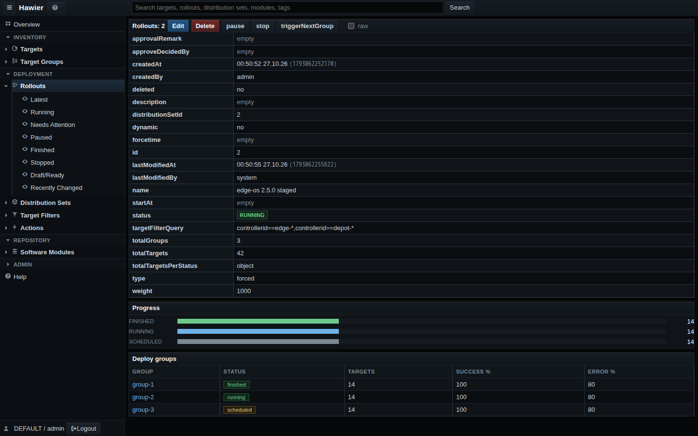
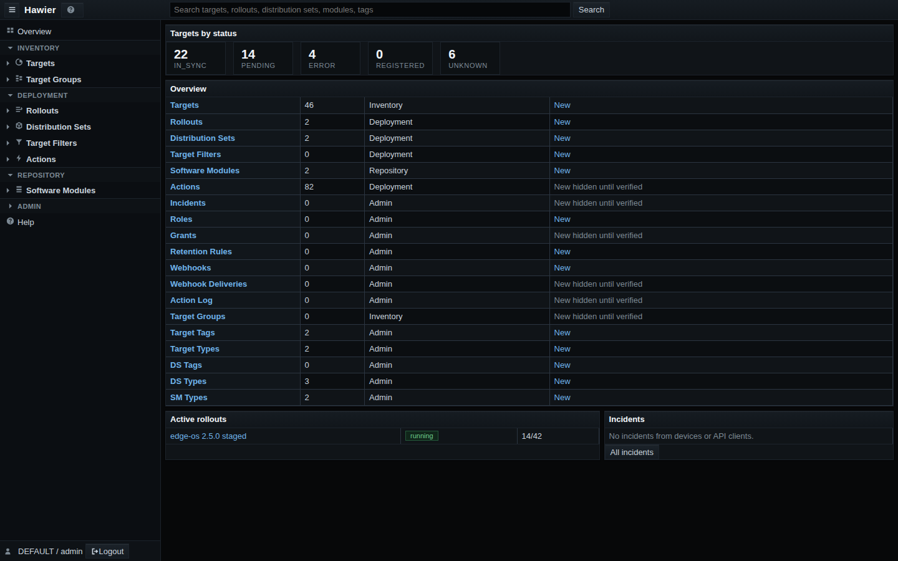
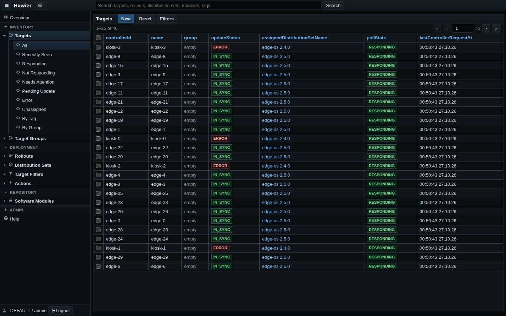
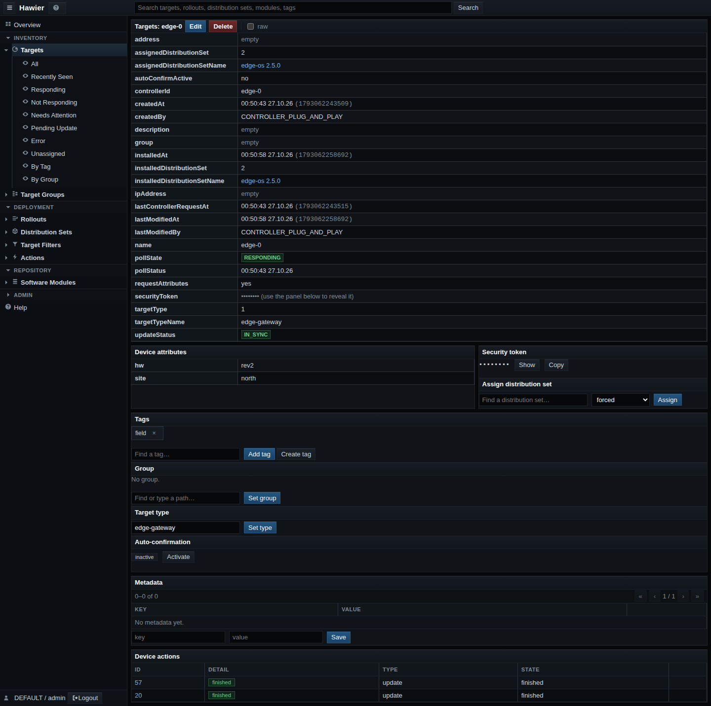
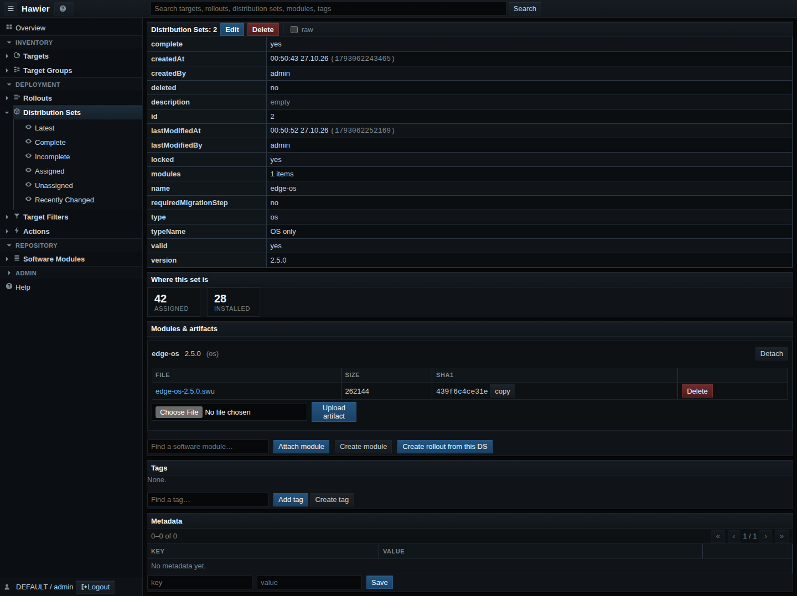

<p align="center">
  <picture>
    <source media="(prefers-color-scheme: dark)" srcset="docs/assets/logo-dark.svg">
    
  </picture>
</p>

<p align="center">
  <b>A self-hosted OTA update server for device fleets.</b><br>
  One binary and PostgreSQL, a live web console, and the hawkBit Mgmt and DDI APIs.
</p>



| | |
|---|---|
|  |  |
|  |  |

## What it does

- **Rollouts in waves.** Groups with success and error thresholds, pause,
  resume and retry — or canary waves over stable buckets. The strategy is a
  pluggable module.
- **Assignments the way fleets need them.** Forced, soft, timed and
  download-only updates, maintenance windows, device confirmation,
  auto-assignment from target filters, type compatibility between devices
  and software.
- **A console that is the product.** Server-rendered, fast lists with
  server-side search, sorting and saved views, bulk actions, an action log,
  incident numbers that open in the UI, and a built-in manual.
- **Speaks hawkBit.** The Mgmt (`/rest/v1`) and DDI APIs follow hawkBit's
  wire contracts. Verified end to end against SWUpdate/suricatta in QEMU;
  RAUC and Zephyr hawkBit clients use the same DDI API but are not tested
  here.
- **Keeps updating when the control node is down.** One control node plus
  any number of sub nodes serving devices; artifacts are streamed, never
  buffered, or redirected to S3.
- **Extends without forks.** Storage, webhooks, retention, permissions,
  rollout strategies and console tabs are sandboxed wasm modules.

PostgreSQL only; AMQP/DMF is deliberately not supported.

## Quick start

You need `cargo`, GNU Make and podman or docker.

```bash
make up
```

- Console: http://localhost:8088 — `admin` / `admin`, tenant `DEFAULT`
- Mgmt API: http://localhost:8080/rest/v1 — HTTP Basic `admin:admin`

Then put a simulated device on it:

```bash
make device ARGS="--controller-id dev-1 --gateway-token <key>"
```

## Deploy to a server

1. Set `ansible_host` of the `server` entry in
   [`deploy/ansible/inventory.yml`](deploy/ansible/inventory.yml) to your
   machine.
2. Run `make deploy-server`.

The images are built here and streamed over ssh — the server downloads
nothing. `make creds-server` prints the login. TLS, small hosts and the
pre-production checklist: [docs/dev/deployment.md](docs/dev/deployment.md).

## Migrating from hawkBit

hawier runs on a hawkBit 1.0 database as it is: it applies hawkBit's own
migrations verbatim and keeps the same Flyway history, so on an existing
database it recognizes what is already applied and adds only its own
`hawier_*` tables. Devices keep their tokens and their API. The schema
compatibility holds for the development stage; details in
[docs/dev/hawkbit-compatibility.md](docs/dev/hawkbit-compatibility.md).

## Documentation

- [docs/dev/](docs/dev/README.md) — building, configuring, measuring and
  deploying hawier
- The console manual — `/help` in the console, sources in
  [apps/ui/docs/](apps/ui/docs/)
- [openspec/specs/](openspec/specs/) — what the system guarantees, one spec
  per capability
- [ARCHITECTURE.md](ARCHITECTURE.md) and [EXTENSIONS.md](EXTENSIONS.md) —
  why it is built this way
